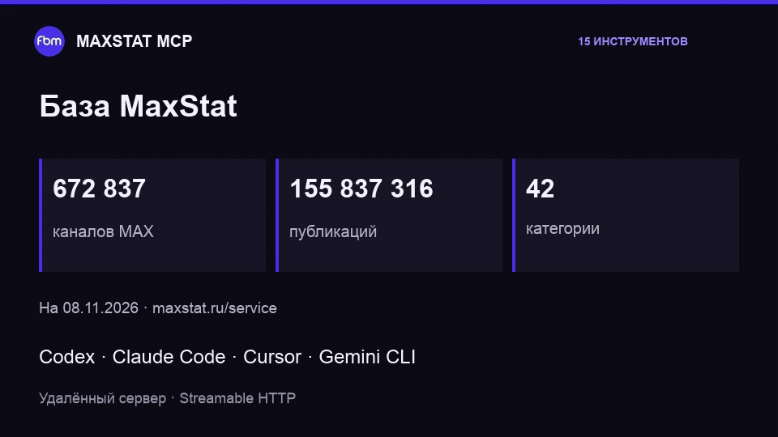

# MaxStat MCP

[](https://modelcontextprotocol.io/)
[](#инструменты-mcp)
[](CHANGELOG.md)
[](LICENSE)
[](https://registry.modelcontextprotocol.io/v0/servers?search=io.github.fbmdata%2Fmaxstat-mcp)
[](https://glama.ai/mcp/connectors/io.github.fbmdata/maxstat-mcp)

**Официальный удалённый MCP-сервер MaxStat для поиска и аналитики
каналов и публикаций в мессенджере MAX.**

Разработчик и оператор: **ООО «ФБМ Аналитикс» / FBM Analytics**.

[Русский](#русский) · [English](#english)

[Получить бесплатный API-токен](https://maxstat.ru/dashboard/api) ·
[Подключить MaxStat MCP](#быстрый-старт) ·
[Посмотреть все 15 инструментов](#инструменты-mcp) ·
[Что нового в MaxStat](UPDATES.md) ·
[Инструкция для AI-установщика](llms-install.md)



> MaxStat размещает и обслуживает MCP-сервер. В репозитории опубликованы
> манифесты, плагины, аналитический skill, клиентские конфигурации и
> документация. Серверная реализация и данные MaxStat не являются открытым
> исходным кодом.

## Русский

### Что нового

**Мониторинг и уведомления.** Отслеживайте каналы и ключевые фразы в публикациях
и комментариях MAX. Получайте события в MAX, Telegram или на Webhook.
Настройка — в [личном кабинете](https://maxstat.ru/dashboard/monitoring).

[Новости сервиса, API и MCP](UPDATES.md) · [Версии интеграции](CHANGELOG.md).
Доступность разделов проверена 8 ноября 2026 года.

### Возможности

MaxStat MCP возвращает карточки каналов и публикаций MAX, историю показателей,
результаты поиска и данные о расходе кредитов.

| Область             | Какие данные возвращает MCP                                                                                                                 |
| ------------------- | ------------------------------------------------------------------------------------------------------------------------------------------- |
| Поиск каналов       | Название, описание, URL, категория, тип доступа, диапазоны аудитории и числа публикаций, сортировка по релевантности, дате или аудитории    |
| Карточка канала     | ID, название, описание, аватар, URL, публичный или закрытый доступ, подписчики, публикации, категории, даты и статус РКН, когда он доступен |
| Динамика аудитории  | Дневные значения, минимум, максимум, абсолютный и процентный рост за выбранный период                                                       |
| Просмотры и реакции | Суммарные, средние и максимальные значения на публикацию и дневная история                                                                  |
| Активность канала   | Число публикаций, дневная история и распределение по тексту, фото, видео, файлам и другим форматам                                          |
| Поиск публикаций    | Поиск по тексту, каналу, формату и датам; сортировка по просмотрам и реакциям                                                               |
| Карточка публикации | Текст и ссылки в нём, URL, вложения, просмотры, реакции, даты, признак удаления и источник пересылки                                        |
| История публикации  | Дневные значения просмотров и реакций                                                                                                       |
| Пересылки           | Найденные репосты, их URL, даты и ID каналов назначения                                                                                     |
| Тариф и расход      | Статус тарифа, период, включённые, купленные, использованные и оставшиеся кредиты и история списаний                                        |

Также можно добавить публичный или доступный по приглашению канал MAX в очередь
сбора данных MaxStat. Это не создаёт мониторинг или Webhook.

Мониторинг и Webhook настраиваются отдельно в
[личном кабинете](https://maxstat.ru/dashboard/monitoring), через MCP они не
управляются. Подробнее — [Мониторинг в личном кабинете](#мониторинг-в-личном-кабинете).

### Размер индекса

<!-- maxstat:index:ru:start -->

| Проверено 8 ноября 2026 года |           Всего |
| ---------------------------- | --------------: |
| Каналы MAX                   |     **672 837** |
| Публикации                   | **155 837 316** |
| Категории                    |          **42** |

[Источник: MaxStat](https://maxstat.ru/service).

<!-- maxstat:index:ru:end -->

Список **15 инструментов** и стоимость вызовов сверены 8 ноября 2026 года с
[публичной OpenAPI-схемой](https://maxstat.ru/api/openapi.json).

### Быстрый старт

1. Создайте токен в
   [личном кабинете MaxStat API](https://maxstat.ru/dashboard/api).
2. Не публикуйте токен и не добавляйте его в Git.
3. Выберите платформу ниже.
4. Перезапустите клиент и проверьте, что доступны 15 инструментов MaxStat.

| Параметр             | Значение                     |
| -------------------- | ---------------------------- |
| Endpoint             | `https://maxstat.ru/api/mcp` |
| Транспорт            | Streamable HTTP              |
| Авторизация          | API-токен                    |
| Заголовок            | `X-API-Token: <API_TOKEN>`   |
| Переменная окружения | `MAXSTAT_API_TOKEN`          |

### Установка по платформам

| Платформа               | Способ                                                  |
| ----------------------- | ------------------------------------------------------- |
| Codex / ChatGPT desktop | Репозиторий-маркетплейс и нативный Codex-плагин         |
| Claude Code             | Claude-compatible marketplace                           |
| VS Code                 | Agent Plugins marketplace или прямой `.vscode/mcp.json` |
| GitHub Copilot CLI      | Общий Claude/Copilot marketplace                        |
| Gemini CLI              | Gemini extension с защищённой настройкой токена         |
| Cursor                  | Установка по ссылке или `~/.cursor/mcp.json`            |
| Windsurf                | `~/.codeium/windsurf/mcp_config.json`                   |
| JetBrains AI Assistant  | MCP-настройки IDE                                       |
| Claude Desktop          | Локальный мост `mcp-remote`                             |
| Cline                   | Удалённый Streamable HTTP из `llms-install.md`          |
| Другие клиенты          | Универсальный Streamable HTTP JSON                      |

#### Codex

До запуска Codex сохраните токен в окружении:

```bash
export MAXSTAT_API_TOKEN="<API_TOKEN>"
```

Добавьте marketplace и установите плагин:

```bash
codex plugin marketplace add fbmdata/maxstat-mcp
codex plugin add maxstat@maxstat-plugins
```

Плагин подключает MCP с пользовательским заголовком `X-API-Token`.
Все конфигурации в этом репозитории используют этот заголовок. Сервер также
принимает `Authorization: Bearer <API_TOKEN>`; при установке по готовым
конфигурациям сохраняйте их способ передачи токена.

Для прямой установки без плагина объедините
[`configs/codex.toml`](configs/codex.toml) со своим
`~/.codex/config.toml`:

```toml
[mcp_servers.maxstat]
url = "https://maxstat.ru/api/mcp"
env_http_headers = { "X-API-Token" = "MAXSTAT_API_TOKEN" }
```

#### Claude Code

```bash
export MAXSTAT_API_TOKEN="<API_TOKEN>"
claude plugin marketplace add fbmdata/maxstat-mcp
claude plugin install maxstat@maxstat-plugins
```

Прямая конфигурация находится в
[`configs/claude-code.json`](configs/claude-code.json).

#### Visual Studio Code

Добавьте marketplace в `settings.json`:

```json
{
  "chat.plugins.marketplaces": ["fbmdata/maxstat-mcp"]
}
```

Откройте Extensions, найдите `@agentPlugins`, выберите `MaxStat MCP` и нажмите
Install. Для прямого подключения скопируйте
[`configs/vscode.json`](configs/vscode.json) в `.vscode/mcp.json`: VS Code
безопасно запросит токен через password input.

#### GitHub Copilot CLI

```bash
export MAXSTAT_API_TOKEN="<API_TOKEN>"
copilot plugin marketplace add fbmdata/maxstat-mcp
copilot plugin install maxstat@maxstat-plugins
```

Claude Code, VS Code и GitHub Copilot CLI используют один совместимый плагин,
skill и MCP-конфигурацию.

#### Gemini CLI

```bash
gemini extensions install https://github.com/fbmdata/maxstat-mcp
```

Расширение запросит `MAXSTAT_API_TOKEN` как чувствительную настройку и подключит
его к заголовку `X-API-Token`. Инструкции Gemini находятся в
[`GEMINI.md`](GEMINI.md).

#### Cursor

[](https://cursor.com/en/install-mcp?name=maxstat&config=eyJ1cmwiOiJodHRwczovL21heHN0YXQucnUvYXBpL21jcCIsImhlYWRlcnMiOnsiWC1BUEktVG9rZW4iOiIke2VudjpNQVhTVEFUX0FQSV9UT0tFTn0ifX0%3D)

Перед запуском Cursor задайте `MAXSTAT_API_TOKEN`, затем нажмите кнопку выше.
Альтернатива: объедините
[`configs/cursor.json`](configs/cursor.json) с `~/.cursor/mcp.json`.

#### Cline

Задайте `MAXSTAT_API_TOKEN` до запуска Cline и передайте агенту
[`llms-install.md`](llms-install.md). Файл содержит конфигурацию удалённого
Streamable HTTP-сервера и проверку подключения. Локальный npm-пакет не нужен:
MaxStat размещает и обслуживает сервер на `https://maxstat.ru/api/mcp`.

#### Windsurf

Задайте `MAXSTAT_API_TOKEN` до запуска Windsurf и объедините
[`configs/windsurf.json`](configs/windsurf.json) с
`~/.codeium/windsurf/mcp_config.json`. Конфигурация использует нативную
подстановку `${env:MAXSTAT_API_TOKEN}`.

#### JetBrains AI Assistant

Откройте **Settings → Tools → AI Assistant → Model Context Protocol (MCP)**,
добавьте HTTP-конфигурацию из
[`configs/jetbrains.json`](configs/jetbrains.json) и замените `<API_TOKEN>`
локально в IDE. JetBrains пока не документирует подстановку переменной
окружения в MCP headers, поэтому placeholder оставлен намеренно.

#### Claude Desktop

Облачный custom connector Claude не принимает произвольный пользовательский
`X-API-Token`. До внедрения OAuth 2.1 используйте локальный мост из
[`configs/claude-desktop.json`](configs/claude-desktop.json). Требуются
Node.js и npm; токен сохраняется только в локальной конфигурации Claude
Desktop.

#### Универсальная конфигурация

Используйте [`configs/generic-mcp.json`](configs/generic-mcp.json):

```json
{
  "mcpServers": {
    "maxstat": {
      "type": "streamable-http",
      "url": "https://maxstat.ru/api/mcp",
      "headers": {
        "X-API-Token": "<API_TOKEN>"
      }
    }
  }
}
```

### Инструменты MCP

Сервер предоставляет **15 инструментов**. `get_account_subscription` возвращает
тариф аккаунта; он не управляет мониторингом или Webhook-подписками.

#### Поиск и каталог

| Инструмент        | Что возвращает или делает                                        |   Кредиты |
| ----------------- | ---------------------------------------------------------------- | --------: |
| `get_categories`  | Категории и актуальное количество каналов в каждой категории     | Бесплатно |
| `search_channels` | Отфильтрованные, отсортированные и постраничные карточки каналов |         3 |
| `get_channel`     | Полная карточка одного канала по идентификатору                  |         1 |
| `add_channel`     | Добавляет публичный или invite-only канал в очередь              | Бесплатно |
| `search_posts`    | Отфильтрованные, отсортированные и постраничные публикации       |         3 |

#### Аналитика каналов

| Инструмент                | Что возвращает                                                    | Кредиты |
| ------------------------- | ----------------------------------------------------------------- | ------: |
| `get_channel_subscribers` | Минимум, максимум, абсолютный и процентный рост и дневную историю |       5 |
| `get_channel_views`       | Суммарные, средние и максимальные просмотры и дневную историю     |       5 |
| `get_channel_likes`       | Суммарные, средние и максимальные реакции и дневную историю       |       5 |
| `get_channel_posts`       | Число публикаций, форматы и дневную историю активности            |       5 |

#### Аналитика публикаций

| Инструмент       | Что возвращает                                                     | Кредиты |
| ---------------- | ------------------------------------------------------------------ | ------: |
| `get_post`       | Контент, вложения, метрики, источник пересылки и найденные репосты |       1 |
| `get_post_views` | Текущее число просмотров и дневную историю                         |       5 |
| `get_post_likes` | Общее число реакций, разбивку по типам и дневную историю           |       5 |

#### Тариф и использование

| Инструмент                 | Что возвращает                                             |   Кредиты |
| -------------------------- | ---------------------------------------------------------- | --------: |
| `get_account_subscription` | Тариф, статус, период и состояние кредитов                 | Бесплатно |
| `get_account_limits`       | Включённые, купленные, использованные и оставшиеся кредиты | Бесплатно |
| `get_account_usage`        | Постраничную историю списаний по запросам                  | Бесплатно |

#### Параметры и ограничения данных

- ID каналов и публикаций передаются строками, включая отрицательные ID.
  Не преобразуйте их в JavaScript `Number`: возможна потеря точности.
- В поиске `limit` — от 1 до 100, `offset` — от 0; `offset + limit` не больше
  10 000. Для больших выборок уточняйте фильтры.
- `search_channels` сортирует по `subscribers`, `posts`, `date` или `score`.
  Для рейтинга по росту сначала получите кандидатов, затем запросите
  `get_channel_subscribers` за один период и отсортируйте их сами. Рейтинг
  относится только к проверенным каналам.
- Даты `date_from` и `date_to` задаются как `YYYY-MM-DD`, обе границы включены.
  Истории каналов без дат используют последние 30 дней. Задавайте обе даты
  явно для сравнения; отсутствие снимков не означает нулевую аудиторию.
- `get_post` возвращает найденные пересылки при `include_forwards=true`.
  По умолчанию список не запрашивается. Пустой список не доказывает, что
  пересылок не было.
- `search_posts` поддерживает `is_deleted`: `true` — удалённые публикации,
  `false` — доступные, без параметра — обе группы. В карточке есть
  `is_deleted`, `deleted_at` и `text_links`; позиции ссылок — в единицах UTF-16.
- `get_account_usage` возвращает `items`, от новых к старым; `limit` — 1–100,
  `offset` — от 0. `request_id` связывает списание с запросом.

#### Ошибки и диагностика

REST API возвращает `code`, `message`, `request_id` и, если есть, `details`.
MCP-клиент может оборачивать эту ошибку в результат вызова инструмента.

| HTTP | Действие |
| ---- | -------- |
| 401 | Проверить токен: он отсутствует, истёк или отозван |
| 402 | Проверить активный период и остаток кредитов |
| 403 | Проверить доступность аккаунта |
| 404 | Проверить ID и наличие данных за период |
| 422 | Исправить параметры по `details` |
| 429 | Снизить частоту запросов и повторить позже |
| 503 | Повторить позже с учётом `Retry-After`, если он доступен клиенту |

При обращении в поддержку передайте `request_id`, без API-токена.
При `Unknown tool` обновите список инструментов в клиенте. Старые
`create_channel_subscription`, `create_keyword_subscription`, `get_subscriptions`,
`get_subscription`, `update_subscription` и `delete_subscription` удалены.

### Мониторинг в личном кабинете

Настраивайте отслеживания в разделе
[«Мониторинг»](https://maxstat.ru/dashboard/monitoring).
Для активации нужен действующий платный тариф и свободное место: одно место
входит в тариф, дополнительные покупаются в кабинете. Приостановленные
мониторинги место не занимают.

Одно отслеживание — **один канал** или **один ключевой запрос**:

- Запрос содержит до **50 фраз** и может искать по всему индексу MaxStat или
  по списку до **100 каналов**. Запрос с таким фильтром занимает одно место.
- Для всех новых публикаций каждого из 50–100 каналов нужны 50–100 отдельных
  отслеживаний и столько же активных мест.
- Для каждого отслеживания действует лимит **1 000 событий в сутки по Москве**.

Webhook необязателен для сохранения событий в истории. Для отправки на ваш
сервер нужен публичный HTTPS-адрес с действительным сертификатом.
Добавьте получателя в разделе
[«Уведомления»](https://maxstat.ru/dashboard/notifications) и выберите его
в мониторинге. Доступны личные чаты, группы и каналы MAX и Telegram, а также
Webhook. Один Webhook можно использовать в нескольких мониторингах.
В одном мониторинге можно выбрать не больше одного получателя каждого типа.
Для мессенджеров действуют отдельные лимиты на получателя: до 10 сообщений
в минуту и 100 событий мониторинга в сутки по Москве.

Webhook-получатель должен ответить 2xx за 5 секунд. Перенаправления не
выполняются, автоматических повторов доставки нет. Сохраняйте событие в очередь
и обрабатывайте асинхронно, учитывая `event_id` для защиты от дублей. После
10 ошибок подряд без успеха за 24 часа Webhook отключается; успешная
«Проверить» в «Уведомлениях» включает его снова.

Мониторинг собирает новые совпадения после создания или изменения условий,
исторические публикации не догоняет. История хранится 90 дней. Состояние
получателя, историю событий, лимиты и стоимость мест смотрите в кабинете.

### Пример на реальных данных

Проверочный запрос к production 29 июля 2026 года вернул:

- канал **MAX • Анонсы** с аудиторией 3 496 789 подписчиков;
- рост с 3 054 001 до 3 496 789 с 30 июня по 29 июля:
  **+442 788 / +14,5%**;
- [публикацию](https://max.ru/max_news/AZ70lsF7P0s) с
  **17 888 688 просмотрами** и **187 460 реакциями**;
- разбивку реакций, дневные истории просмотров и реакций;
- 184 найденных пересылки.

Значения показывают структуру реального ответа и не являются обещанием
фиксированных показателей продукта.

### Примеры запросов

```text
Найди 20 технологических каналов MAX с максимальным приростом подписчиков за
последние 30 дней. Верни ссылки, текущую аудиторию и процент роста.
```

```text
Сравни пять каналов по аудитории, средним просмотрам, реакциям, частоте
публикаций и распределению форматов.
```

```text
Найди публикации об ипотеке за июль. Верни ссылки, текст, вложения, просмотры,
детальные реакции и найденные пересылки.
```

```text
Объясни, как в личном кабинете настроить мониторинг фраз «искусственный
интеллект» в 80 выбранных каналах и подключить Webhook.
```

```text
Покажи мой тариф MaxStat, остаток кредитов и десять последних списаний.
```

### Тарифы и безопасность

MCP входит во все [тарифы MaxStat API](https://maxstat.ru/promo/api) без
дополнительной оплаты. MCP и прямые вызовы API используют единый баланс
кредитов. Текущие условия тестового доступа, объём кредитов и окончание периода
проверяйте в кабинете и через `get_account_subscription` / `get_account_limits`.

Никогда не публикуйте настоящий API-токен в issue, PR, конфигурации, логе или
скриншоте. Об уязвимостях сообщайте по инструкции из
[`SECURITY.md`](SECURITY.md).

## English

### What's new

**Monitoring and notifications.** Track channels and keyword matches in MAX
posts and comments. Receive events in MAX, Telegram, or through a webhook.
Configure them in the [dashboard](https://maxstat.ru/dashboard/monitoring).

[Service, API, and MCP news](UPDATES.md) (Russian) · [Integration versions](CHANGELOG.md).
Dashboard sections checked on November 8, 2026.

MaxStat MCP gives AI agents structured access to the live MAX messenger channel
and publication index. It supports channel and post discovery, daily audience,
view and reaction histories, publishing activity, attachment and reaction
details, deletion flags, forward detection, and account credit usage.
The public OpenAPI contract was checked on November 8, 2026: **15 tools**.
<!-- maxstat:index:en:start -->

Checked November 8, 2026: **672,837 channels**,
**155,837,316 posts**, **42 categories**.
[Source: MaxStat](https://maxstat.ru/service).

<!-- maxstat:index:en:end -->

### Connection

| Parameter       | Value                                                        |
| --------------- | ------------------------------------------------------------ |
| Endpoint        | `https://maxstat.ru/api/mcp`                                 |
| Transport       | Streamable HTTP                                              |
| Header          | `X-API-Token: <API_TOKEN>`                                   |
| Token dashboard | [maxstat.ru/dashboard/api](https://maxstat.ru/dashboard/api) |

### Install

#### Codex

```bash
export MAXSTAT_API_TOKEN="<API_TOKEN>"
codex plugin marketplace add fbmdata/maxstat-mcp
codex plugin add maxstat@maxstat-plugins
```

#### Claude Code

```bash
export MAXSTAT_API_TOKEN="<API_TOKEN>"
claude plugin marketplace add fbmdata/maxstat-mcp
claude plugin install maxstat@maxstat-plugins
```

#### GitHub Copilot CLI

```bash
export MAXSTAT_API_TOKEN="<API_TOKEN>"
copilot plugin marketplace add fbmdata/maxstat-mcp
copilot plugin install maxstat@maxstat-plugins
```

#### Gemini CLI

```bash
gemini extensions install https://github.com/fbmdata/maxstat-mcp
```

For VS Code, Cursor, Windsurf, JetBrains AI Assistant, Claude Desktop, and
generic clients, use the checked-in [`configs/`](configs/) directory. The
Russian section above contains detailed client-specific instructions.

### Capabilities

- Search and filter MAX channels and publications.
- Retrieve channel profiles, audience growth, views, reactions, activity, and
  content-format mix.
- Retrieve post text, attachments, metrics, reaction details, histories, and
  detected forwards.
- Add a MAX channel to the collection queue; this does not create monitoring.
- Inspect the active MaxStat plan, credit balance, and request-level usage.

The complete 15-tool contract, credit costs, data limits, and error handling are
documented in [Инструменты MCP](#инструменты-mcp). Channel and post IDs are strings;
search pages contain 1–100 items and `offset + limit` cannot exceed 10,000.
Use `get_post` with `include_forwards=true` to request detected forwards.

### Monitoring and webhooks

Monitoring is configured in the [dashboard](https://maxstat.ru/dashboard/monitoring),
outside MCP. The six old webhook-subscription tools have been removed.
`get_account_subscription` remains available for billing information.

An active paid plan includes one monitoring slot; extra slots are purchased
separately. Paused monitors do not occupy slots. One monitor tracks one channel
or one keyword query of up to 50 phrases, optionally restricted to 100 channels.
A query covering 80 channels takes one slot; collecting every new post from
80 channels takes 80 monitors and active slots. Each monitor records up to
1,000 events per Moscow calendar day; history is retained for 90 days.

Webhook delivery needs a public HTTPS endpoint. Add a recipient in
[Notifications](https://maxstat.ru/dashboard/notifications) and select it in
the monitor. MAX and Telegram support private chats, groups, and channels.
Messenger delivery is limited to 10 messages per minute and 100 monitoring
events per Moscow calendar day per recipient. One webhook
can serve several monitors, with at most one recipient of each type per monitor.
Respond with 2xx within five seconds; redirects and automatic delivery retries
are not supported. Deduplicate by `event_id`. A webhook is disabled after ten
consecutive failures without a success for 24 hours; a successful dashboard
check re-enables it. Historical events are not backfilled.

### Authentication boundary

This release supports clients that can send the custom `X-API-Token` header.
Publishing as a fully hosted ChatGPT or Claude cloud connector requires a
separate OAuth 2.1 implementation.

## Ссылки / Links

- [MaxStat MCP](https://maxstat.ru/promo/mcp)
- [Получить API-токен / Get a token](https://maxstat.ru/dashboard/api)
- [Документация API / API documentation](https://maxstat.ru/api/docs)
- [Тарифы API / API plans](https://maxstat.ru/promo/api)
- [ООО «ФБМ Аналитикс» / FBM Analytics](https://fbmdata.ru)
- [MaxStat Insights в MAX](https://max.ru/maxstat)
- [FBM API Insights в Telegram](https://t.me/fbmapi)

## Лицензия / License

MIT распространяется только на опубликованные в этом репозитории манифесты,
плагины, skill, конфигурации, документацию и вспомогательные проверки. Лицензия
не распространяется на сервис MaxStat, API, данные, базы данных, товарные знаки
и серверную реализацию. Подробности приведены в [`NOTICE`](NOTICE).
